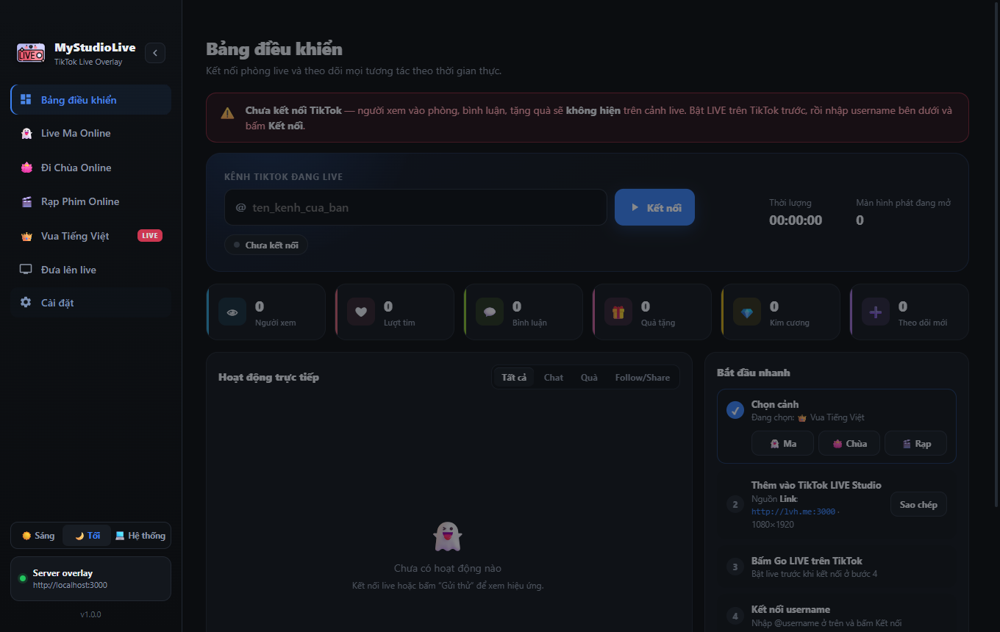
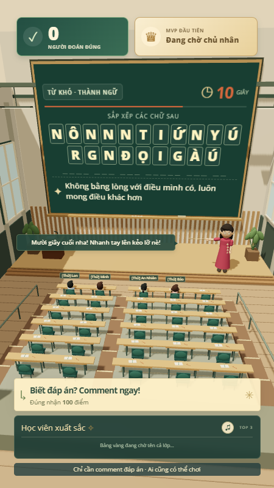

<p align="center">
  
</p>

<h1 align="center">MyStudioLive</h1>

<p align="center">
  <b>English</b> | <a href="README.md">Tiếng Việt</a>
</p>

<p align="center">
  <a href="LICENSE"></a>
  
  
</p>

A desktop app that creates **interactive scenes for TikTok LIVE**: viewers comment, send likes and gifts, and the scene on the stream reacts instantly. Everything runs on your own computer, with no external server.

MyStudioLive builds on [StudioLive](https://github.com/tanthuan031/StudioLive) by Tanthuan031 (MIT) and adds two games, **Vua Tiếng Việt** (word puzzle) and **Kéo Co Online** (tug of war), a light/dark interface and a new identity.

> ⚠️ **Read the [Disclaimer](DISCLAIMER.md) (Vietnamese) before use.** Using the app for scams, profiteering, exploiting religious beliefs or any illegal livestream is strictly prohibited. MyStudioLive is not affiliated with TikTok / ByteDance.

> The app interface and in-scene chat commands are in Vietnamese.



## Scenes

Whichever tab is open in the left menu is the scene shown on the live stream. All scenes share **one TikTok connection** on the Dashboard.

| Scene | What viewers do | Highlights |
|---|---|---|
| 👻 **Live Ma Online** (Haunted House) | Type `hù` (boo) / `trốn` (hide) / `tìm` (seek) / `bùa` (talisman) / `gọi hồn` (summon) / `tắt đèn` (lights out)… | Every viewer is a ghost; big gifts summon the Granny Ghost + a jumpscare; periodic hide-and-seek rounds |
| 🪷 **Đi Chùa Online** (Temple Visit) | Type `adidaphat` to light incense | Temple hall with a voice that thanks and blesses; gifts bloom golden lotuses; like goals trigger a lotus shower |
| 🎬 **Rạp Phim Online** (Movie Theater) | Type `vỗ tay` (clap) / `haha` / `wow` / `bắp` (popcorn) | Plays a YouTube, .mp4/.webm or local-file playlist; gifts = VIP seats; 4 room styles |
| 👑 **Vua Tiếng Việt** (Word King) | Comment the answer to a scrambled word | 3D lecture hall with a narrating teacher; first correct answer is MVP; 550+ questions, import more |
| 🪢 **Kéo Co Online** (Tug of War) | Comment `ĐỎ` (red) / `XANH` (blue) to join, send likes to pull | 3D arena, 5 per team with bots filling gaps; gifts add pull points and team mana |
| 🧊 **Trà Đá Vỉa Hè** (Sidewalk Iced Tea) | Type `trà đá` / `cà phê` / `coca` / `bò húc` / `hướng dương` / `bánh mì` / `tính tiền` (pay & leave) | Hanoi sidewalk stall where every viewer gets a chibi on a plastic stool; the owner serves orders to the table; big gifts make the gifter the "đại ca" who treats everyone |
| 🍺 **Đi Nhậu Online** (Night Pub) | Type `bia` (beer) / `dzô` (cheers) / `lạc` / `mực` / `lẩu` / `tính tiền` | 6 tables × 4 seats; whole tables clink glasses, heavy drinkers turn red and doze off; drinking leaderboard; big gifts buy a round for the house |

| 👻 Live Ma Online | 🪷 Đi Chùa Online | 🎬 Rạp Phim Online | 👑 Vua Tiếng Việt |
|---|---|---|---|
|  |  |  |  |

### 👑 Vua Tiếng Việt

- The board shows scrambled letters and a hint; viewers **comment the full answer**, with no command or sign-up. Answers without Vietnamese accents count too (can be turned off).
- The first correct viewer is the **MVP** (default +100 points); each letter the host reveals lowers the reward by 20 (minimum 10).
- Viewers who join get a seat in the hall (up to 50); their name and answer appear next to the seat.
- **Normal / Hard / Mixed** difficulty; import more questions from a JSON file (a template is available in the control panel).
- **Practice mode** simulates joins, comments and gifts without going live.
- Background music while solving (a YouTube link or the built-in track), lowered automatically while the teacher speaks.

### 🪢 Kéo Co Online

- Red vs Blue, 5 players per team on the field; later arrivals queue in the stands and rotate in.
- Each like = 1 pull point (×2 in the last 10 seconds of regulation); gifts add pull points by diamond value and charge team mana.
- Default round: line-up 5s → countdown 3s → pull 45s → result 10s, with overtime on a tie. All adjustable in the control panel.
- Players who stay silent on the field go back to the stands; a comment or like brings them back.

### 🧊 Trà Đá Vỉa Hè & 🍺 Đi Nhậu Online

- A viewer's first comment seats them (20 seats / 24 seats) as a chibi whose look is fixed per account; when full, simulated regulars leave first, then the longest-silent viewer.
- Typing a menu item orders it; staff carry it to the table and the customer sips over time. Other comments appear as speech bubbles. `tính tiền` makes the customer pay and leave.
- **Đi Nhậu**: `dzô` (or `100%`, `cạn ly`…) makes the whole table clink and down their beer; each finished beer counts on the leaderboard. Drunk customers blush, hiccup, sway and eventually doze on the table. A "don't drink and drive" ticker is always on screen.
- Gifts: free items for small gifts, a treat for the whole table from 10 💎, and from the **big gift** threshold the gifter becomes the boss (sunglasses, gold chain) and treats the whole place while the camera zooms in.
- Like goals: free iced tea for everyone with falling ice / a house-wide 100% cheers.
- Optional simulated regulars keep an empty stall lively and give up their seats to real viewers. Street / pub ambience is synthesized with WebAudio.

## Download & install

Get the latest installer from **[Releases](https://github.com/luhau983/MyStudioLive/releases)**. If there is no build for your machine, [build it from source](#run-from-source).

| Computer | File |
|---|---|
| Windows 10/11 64-bit | `MyStudioLive-Setup-<version>-win-x64.exe` |
| Mac with Apple chip (M1–M4) | `MyStudioLive-<version>-mac-arm64.dmg` |
| Mac with Intel chip | `MyStudioLive-<version>-mac-x64.dmg` |

<details>
<summary><b>Windows</b></summary>

1. Run the `.exe` → choose a folder → **Install**.
2. If **“Windows protected your PC”** appears (SmartScreen, the app is unsigned): click **More info → Run anyway**.
3. Open **MyStudioLive** from the Desktop or Start menu.

</details>

<details>
<summary><b>macOS 12 or later</b></summary>

1. Open the `.dmg` and drag **MyStudioLive** into **Applications**.
2. First launch: **right-click the app → Open → Open** (the app is not signed by Apple).
3. Still blocked: **System Settings → Privacy & Security → Open Anyway**.
4. If macOS says the app “is damaged and can’t be opened”, run this in Terminal and open it again:

   ```bash
   xattr -cr /Applications/MyStudioLive.app
   ```

</details>

## Going live

1. **Pick a scene** in the left menu (or **Đưa lên live → Phát …**).
2. **Add the scene to your streaming software** as a **vertical 1080 × 1920** source:
   - **TikTok LIVE Studio**: add a **Link** source `http://lvh.me:3000` (LIVE Studio rejects `localhost`; `lvh.me` always points to your own machine). Fallback: click **Mở màn hình phát** (open output window) and use **Window capture**.
   - **OBS**: add a **Browser Source** `http://localhost:3000`.
3. Press **Go LIVE** on TikTok.
4. On the **Dashboard**, enter your TikTok username (no @) → **Kết nối** (Connect).

Switching scenes needs no link change: every screen pointing at `localhost:3000` / `lvh.me:3000` follows the new scene automatically. Before going live, try everything with the **Gửi thử** (send test) / **Chơi thử** (practice) buttons in each tab.

Full guide (Vietnamese; picture quality, audio, troubleshooting): **[docs/HUONG-DAN-CAI-DAT.md](docs/HUONG-DAN-CAI-DAT.md)**.

## Your data

| Content | Windows | macOS |
|---|---|---|
| App settings | `%APPDATA%\StudioLive\settings.json` | `~/Library/Application Support/StudioLive/settings.json` |
| Vua Tiếng Việt (questions, scores, config) | `%APPDATA%\StudioLive\vua\` | `~/Library/Application Support/StudioLive/vua/` |
| Kéo Co (config, stats, match history) | `%APPDATA%\StudioLive\keoco\` | `~/Library/Application Support/StudioLive/keoco/` |

The data folder keeps the `StudioLive` name so existing settings survive the rename. If the standalone **Vua Tiếng Việt** app was installed before, MyStudioLive copies its imported questions, scores and config on first launch.

## Run from source

Requires **Node.js 20+** and **git**.

```bash
git clone https://github.com/luhau983/MyStudioLive.git
cd MyStudioLive
npm install
npm start
```

Build unsigned installers (see [docs/BUILD.md](docs/BUILD.md), Vietnamese):

```bash
npm run dist:win   # NSIS installer, x64
npm run dist:mac   # .dmg + .zip for arm64 and x64
```

Run the game test suites:

```bash
cd vua && node --test
cd keoco && node --test
```

### Architecture

```
src/main.js        Main process: windows, IPC, starts the overlay server and each game's server
src/live.js        TikTok connection, event normalisation, auto-reconnect (one shared connection)
src/direct.js      Reads events through a hidden browser + protobuf decoding
src/server.js      Express + Socket.IO overlay server (127.0.0.1 only), /api/tts voice,
                   redirects to a game's server while that scene is on air
src/tts.js         Vietnamese voice (Microsoft Edge, Google fallback)
src/settings.js    Settings stored in the userData folder
renderer/          Control UI (light / dark / system)
overlay/           Haunted House, Temple and Movie Theater scenes; quan.js = shared engine for Iced Tea & Night Pub
vua/               Vua Tiếng Việt: own server, 3D overlay (Three.js), control panel, question bank
keoco/             Kéo Co: own server, 3D arena (Three.js), control panel
```

The `vua/` and `keoco/` games run their own servers inside the main process and receive events through a bridge from `src/live.js`, so the whole app keeps a single TikTok connection. Each game's control panel is embedded in its tab; the Vua Tiếng Việt panel follows MyStudioLive's light/dark theme (`vua/studio-theme.css`).

> Note: keep `tiktok-live-connector` at **2.0.0** (MIT). Newer versions are licensed AGPL-3.0.

### Contributing

Fork → create a branch → commit → open a Pull Request. Report bugs or suggest features in [Issues](https://github.com/luhau983/MyStudioLive/issues).

## License & credits

- Source code is released under the **[MIT License](LICENSE)**.
- Based on [StudioLive](https://github.com/tanthuan031/StudioLive) © 2026 [Tanthuan031](https://github.com/tanthuan031) (MIT).
- Third-party libraries and assets keep their own licenses: [docs/THIRD_PARTY_NOTICES.md](docs/THIRD_PARTY_NOTICES.md).
- **[DISCLAIMER.md](DISCLAIMER.md)** (Vietnamese): this software is for entertainment and learning only. Users are solely responsible for their livestream content.

## Authors

- MyStudioLive development & maintenance: [@luhau983](https://github.com/luhau983)
- Original StudioLive author: **Tanthuan031** · [GitHub](https://github.com/tanthuan031) · [Website](https://thuantech.com) · [Facebook](https://www.facebook.com/thuanht31) · [TikTok](https://www.tiktok.com/@rv.dev)
