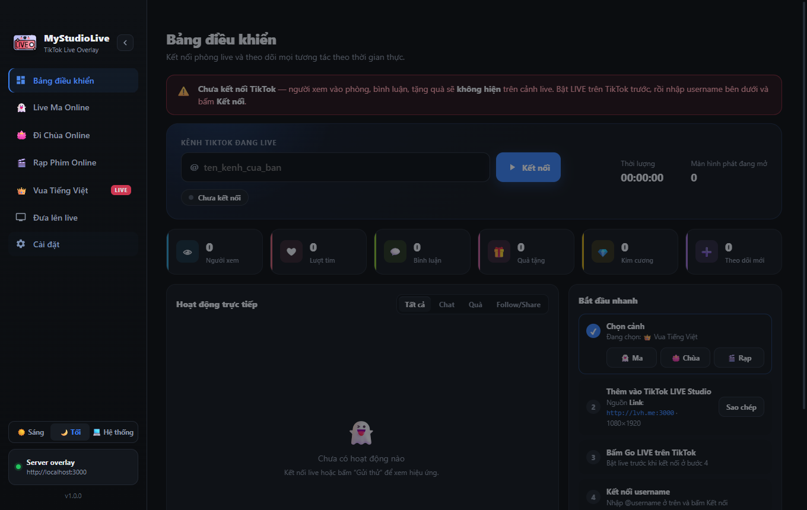
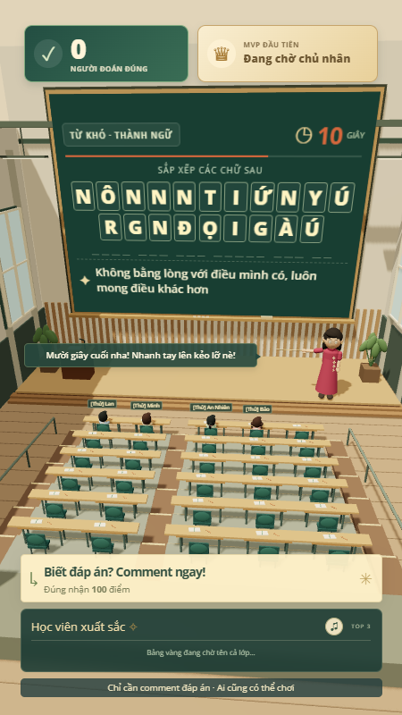

<p align="center">
  
</p>

<h1 align="center">MyStudioLive</h1>

<p align="center">
  <a href="README.en.md">English</a> | <b>Tiếng Việt</b>
</p>

<p align="center">
  <a href="LICENSE"></a>
  
  
</p>

App máy tính tạo **cảnh tương tác cho TikTok LIVE**: người xem bình luận, thả tim, tặng quà là cảnh trên live phản ứng ngay. Chạy hoàn toàn trên máy của bạn, không cần server ngoài.

MyStudioLive phát triển tiếp từ [StudioLive](https://github.com/tanthuan031/StudioLive) của Tanthuan031 (MIT), bổ sung hai game **Vua Tiếng Việt** và **Kéo Co Online**, giao diện sáng/tối và nhận diện mới.

> ⚠️ **Đọc [Tuyên bố miễn trừ trách nhiệm](DISCLAIMER.md) trước khi dùng.** Nghiêm cấm dùng app để lừa đảo, trục lợi, lợi dụng tín ngưỡng hay livestream vi phạm pháp luật. MyStudioLive không liên kết với TikTok / ByteDance.



## Các cảnh

Mở tab nào ở menu trái thì cảnh đó chạy trên live. Mọi cảnh dùng chung **một kết nối TikTok** ở Bảng điều khiển.

| Cảnh | Người xem làm gì | Điểm nhấn |
|---|---|---|
| 👻 **Live Ma Online** | Gõ `hù` / `trốn` / `tìm` / `bùa` / `gọi hồn` / `tắt đèn`… | Mỗi người là một con ma; quà lớn gọi Bà Ma + jumpscare; vòng TRỐN TÌM định kỳ |
| 🪷 **Đi Chùa Online** | Gõ `adidaphat` để lên thắp hương | Chánh điện, giọng đọc cảm ơn và chúc; quà làm sen vàng nở; đủ tim thì mưa hoa sen |
| 🎬 **Rạp Phim Online** | Gõ `vỗ tay` / `haha` / `wow` / `bắp` | Chiếu playlist YouTube, link .mp4/.webm hoặc file trên máy; quà = ghế VIP; 4 kiểu phòng |
| 👑 **Vua Tiếng Việt** | Comment đáp án ô chữ bị xáo | Giảng đường 3D, cô giáo đọc lời dẫn; ai đúng đầu tiên là MVP; 550+ câu, import thêm được |
| 🪢 **Kéo Co Online** | Comment `ĐỎ` / `XANH` để vào đội, thả tim để kéo | Sân kéo co 3D, 5 người mỗi đội, bot bù chỗ; quà cộng điểm kéo và nạp mana |
| 🪩 **Live Bar** | Gõ `hey` để vào sàn, `dance` / `nhảy` / `đi vòng` / `đổi nv` | Sàn nhảy 3D với avatar TikTok thật; quà zoom camera, đèn rọi, danh hiệu, pháo hoa; TOP 3 lên bục DJ |

| 👻 Live Ma Online | 🪷 Đi Chùa Online | 🎬 Rạp Phim Online | 👑 Vua Tiếng Việt |
|---|---|---|---|
|  |  |  |  |

### 👑 Vua Tiếng Việt

- Bảng hiện các chữ cái bị xáo kèm gợi ý; người xem **comment nguyên đáp án**, không cần lệnh hay đăng ký. Đáp án không dấu cũng được tính (tắt được).
- Người đúng đầu tiên là **MVP** (mặc định +100 điểm); mỗi lần host mở thêm một chữ, điểm giảm 20 (tối thiểu 10).
- Người vào live được xếp ghế trong giảng đường (tối đa 50 chỗ); tên và câu trả lời hiện cạnh chỗ ngồi.
- Độ khó **Thường / Khó / Trộn**; import thêm câu hỏi bằng file JSON (có file mẫu trong bảng điều khiển).
- Có **chế độ chơi thử**: giả lập người vào, bình luận, tặng quà mà không cần lên live.
- Nhạc nền khi làm bài (link YouTube hoặc nhạc mặc định), tự giảm khi cô giáo nói.

### 🪩 Live Bar

- Người xem gõ từ khoá (mặc định `hey`) hoặc tặng quà để bước lên sàn nhảy; chế độ "mọi người tương tác" cho ai bình luận cũng vào sàn. Tối đa 400 người, im lặng 10 phút thì rời sàn; khách ảo giữ sàn không trống.
- Lệnh chat: `dance` nhảy, `nhảy` bật nhảy, `đi vòng` dạo quanh sàn, `đổi nv` đổi nhân vật.
- Quà theo tên: Hoa hồng zoom camera, TikTok đổi nhân vật, Finger Heart đi vòng, Portal hoá khổng lồ, Galaxy lên TOP DJ + pháo hoa. Quà khác theo kim cương: 20 camera, 50 danh hiệu VUA SÀN NHẢY, 100–200 VIP camera + đèn rọi, 500+ mưa pháo hoa.
- Tặng nhiều thì nhân vật tiến hoá (10 / 50 / 200 / 1000 💎); TOP 3 người tặng đứng trên bục trước bàn DJ, hạng nhất có vương miện.
- Thanh PARTY ENERGY đầy: cả sàn cùng quẩy, drop đèn laser, bắn pháo hoa. Có nền xanh lá để ghép trong OBS.
- **Master Rules**: tự đặt luật "quà / từ khoá chat → hành động" (zoom, VIP, danh hiệu, khổng lồ, pháo hoa…) ngay trong tab, xét trước bảng quà mặc định; bấm vào quà vừa nhận để tạo luật theo Gift ID.
- Màn LED sau bàn DJ phát ảnh hoặc video của bạn (mặc định là màn LED nhảy theo nhạc); nhạc nền chọn file trên máy.
- **Bộ nhân vật GIF**: chọn một thư mục GIF / PNG / WEBP, mỗi người xem nhận một nhân vật động (giống bản gốc), `đổi nv` để đổi. Trỏ thẳng được vào `TikTokBridge/assets/gifs` của tiktok-live-bar; tiếng pháo hoa cũng chọn được file riêng. Các tài nguyên đó không đi kèm MyStudioLive vì không rõ giấy phép — tự kiểm tra trước khi dùng trên live.
- Chuyển thể luật chơi từ [tiktok-live-bar](https://github.com/cherry9001/tiktok-live-bar) (MIT); cảnh 3D viết lại bằng three.js, chạy như các cảnh khác (một link cho LIVE Studio / OBS).

### 🪢 Kéo Co Online

- Hai đội ĐỎ – XANH, mỗi đội 5 người trên sân; người đến sau xếp hàng chờ trên khán đài và được luân phiên lên sân.
- Mỗi tim = 1 điểm kéo (×2 trong 10 giây cuối hiệp chính); quà cộng thẳng điểm kéo theo số kim cương và nạp mana cho đội.
- Vòng mặc định: sắp đội 5s → đếm ngược 3s → kéo 45s → kết quả 10s; hòa thì có hiệp phụ. Chỉnh được trong bảng điều khiển.
- Người im lặng lâu trên sân tự xuống khán đài; comment hoặc thả tim là quay lại.

## Tải & cài đặt

Tải bản cài mới nhất ở trang **[Releases](https://github.com/luhau983/MyStudioLive/releases)**. Chưa có bản phù hợp thì [tự đóng gói từ mã nguồn](#chạy-từ-mã-nguồn).

| Máy | File |
|---|---|
| Windows 10/11 64-bit | `MyStudioLive-Setup-<phiên bản>-win-x64.exe` |
| Mac chip Apple (M1–M4) | `MyStudioLive-<phiên bản>-mac-arm64.dmg` |
| Mac chip Intel | `MyStudioLive-<phiên bản>-mac-x64.dmg` |

<details>
<summary><b>Windows</b></summary>

1. Chạy file `.exe` → chọn thư mục → **Install**.
2. Hiện **“Windows đã bảo vệ PC của bạn”** (SmartScreen, do app chưa ký số): bấm **More info → Run anyway**.
3. Mở **MyStudioLive** từ Desktop hoặc menu Start.

</details>

<details>
<summary><b>macOS 12 trở lên</b></summary>

1. Mở file `.dmg`, kéo **MyStudioLive** vào **Applications**.
2. Lần đầu: **chuột phải vào app → Mở → Mở** (app chưa ký số Apple).
3. Vẫn bị chặn: **Cài đặt hệ thống → Quyền riêng tư & Bảo mật → Vẫn mở**.
4. Báo “app bị hỏng và không thể mở”: chạy lệnh sau trong Terminal rồi mở lại.

   ```bash
   xattr -cr /Applications/MyStudioLive.app
   ```

</details>

## Lên live

1. **Chọn cảnh** ở menu trái (hoặc tab **Đưa lên live → Phát …**).
2. **Đưa cảnh vào phần mềm live**, khung **dọc 1080 × 1920**:
   - **TikTok LIVE Studio**: thêm nguồn **Link** `http://lvh.me:3000` (LIVE Studio không nhận `localhost`; `lvh.me` luôn trỏ về chính máy bạn). Dự phòng: bấm **Mở màn hình phát** rồi dùng **Chụp cửa sổ**.
   - **OBS**: thêm **Browser Source** `http://localhost:3000`.
3. Bấm **Go LIVE** trên TikTok.
4. Ở **Bảng điều khiển**, nhập username TikTok (không cần @) → **Kết nối**.

Đổi cảnh giữa chừng không cần sửa link: mọi màn hình đang trỏ tới `localhost:3000` / `lvh.me:3000` tự chuyển sang cảnh mới. Chưa live vẫn thử được bằng các nút **Gửi thử** / **Chơi thử** trong từng tab.

Hướng dẫn chi tiết (chất lượng hình, âm thanh, xử lý lỗi): **[docs/HUONG-DAN-CAI-DAT.md](docs/HUONG-DAN-CAI-DAT.md)**.

## Dữ liệu của bạn

| Nội dung | Windows | macOS |
|---|---|---|
| Cài đặt app | `%APPDATA%\StudioLive\settings.json` | `~/Library/Application Support/StudioLive/settings.json` |
| Vua Tiếng Việt (câu hỏi, điểm, cấu hình) | `%APPDATA%\StudioLive\vua\` | `~/Library/Application Support/StudioLive/vua/` |
| Kéo Co (cấu hình, thống kê, lịch sử trận) | `%APPDATA%\StudioLive\keoco\` | `~/Library/Application Support/StudioLive/keoco/` |

Thư mục dữ liệu vẫn tên `StudioLive` để giữ cài đặt cũ sau khi đổi tên app. Nếu máy đã từng cài app **Vua Tiếng Việt** riêng, lần đầu mở MyStudioLive sẽ tự chép câu hỏi đã import, điểm và cấu hình sang.

## Chạy từ mã nguồn

Cần **Node.js 20+** và **git**.

```bash
git clone https://github.com/luhau983/MyStudioLive.git
cd MyStudioLive
npm install
npm start
```

Đóng gói bản cài (không ký số), xem thêm [docs/BUILD.md](docs/BUILD.md):

```bash
npm run dist:win   # bộ cài NSIS x64
npm run dist:mac   # .dmg + .zip cho arm64 và x64
```

Chạy test của hai game:

```bash
cd vua && node --test
cd keoco && node --test
npm test             # Live Bar (luật chơi + proxy avatar)
```

### Kiến trúc

```
src/main.js        Tiến trình chính: cửa sổ, IPC, khởi động server overlay + server của từng game
src/live.js        Kết nối TikTok, chuẩn hoá sự kiện, tự kết nối lại (một kết nối dùng chung)
src/direct.js      Đọc sự kiện qua trình duyệt ẩn + giải mã protobuf
src/server.js      Server overlay Express + Socket.IO (chỉ 127.0.0.1), giọng đọc /api/tts,
                   chuyển hướng sang server game khi cảnh đó đang phát
src/tts.js         Giọng đọc tiếng Việt (Microsoft Edge, dự phòng Google)
src/settings.js    Lưu cài đặt trong thư mục userData
renderer/          Giao diện điều khiển (sáng / tối / theo hệ thống)
overlay/           Cảnh Nhà Ma, Đi Chùa, Rạp Phim; overlay/bar/ là Live Bar (three.js)
vua/               Game Vua Tiếng Việt: server riêng, overlay 3D (Three.js), bảng điều khiển, ngân hàng câu hỏi
keoco/             Game Kéo Co: server riêng, sân 3D (Three.js), bảng điều khiển
```

Hai game `vua/` và `keoco/` chạy server riêng ngay trong tiến trình chính và nhận sự kiện qua cầu nối từ `src/live.js`, nên chỉ có một kết nối TikTok cho cả app. Bảng điều khiển của từng game được nhúng vào tab tương ứng; bảng của Vua Tiếng Việt đổi theo giao diện sáng/tối của MyStudioLive (`vua/studio-theme.css`).

> Lưu ý: giữ `tiktok-live-connector` ở **2.0.0** (MIT). Các bản mới hơn dùng giấy phép AGPL-3.0.

### Đóng góp

Fork repo → tạo nhánh → commit → mở Pull Request. Báo lỗi hoặc đề xuất tính năng tại [Issues](https://github.com/luhau983/MyStudioLive/issues).

## Giấy phép & ghi công

- Mã nguồn phát hành theo giấy phép **[MIT](LICENSE)**.
- Dựa trên [StudioLive](https://github.com/tanthuan031/StudioLive) © 2026 [Tanthuan031](https://github.com/tanthuan031) (MIT).
- Thư viện & tài nguyên bên thứ ba giữ giấy phép riêng: [docs/THIRD_PARTY_NOTICES.md](docs/THIRD_PARTY_NOTICES.md).
- **[DISCLAIMER.md](DISCLAIMER.md)**: phần mềm chỉ phục vụ giải trí, học tập. Người dùng tự chịu hoàn toàn trách nhiệm về nội dung livestream của mình.

## Tác giả

- Phát triển & duy trì MyStudioLive: [@luhau983](https://github.com/luhau983)
- Tác giả StudioLive gốc: **Tanthuan031** · [GitHub](https://github.com/tanthuan031) · [Website](https://thuantech.com) · [Facebook](https://www.facebook.com/thuanht31) · [TikTok](https://www.tiktok.com/@rv.dev)
