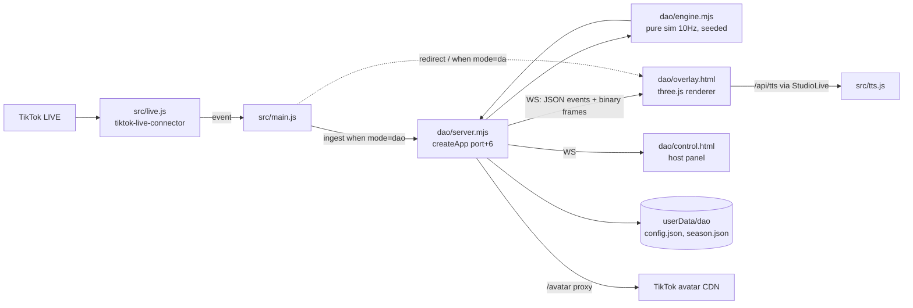

# Đảo Sinh Tồn — Game Design (v0.2, implemented in `dao/`)

Battle royale for TikTok LIVE. Every viewer who comments drops onto an island as an avatar; a storm shrinks the safe zone; last one standing wins.
Draft 2026-11-05. Numbers are starting points for tuning, not final. §12 lists where the first implementation differs from this draft.

---

## 1. Design pillars

1. **Viewers decide strategy, never reflexes.** Comment latency is 2–5 s and bursty, so avatars fight on their own (auto-battler). Viewers pick a class, a landing zone and a stance.
2. **Every death has a readable cause.** HP bars, a visible storm and a kill feed show why someone died. Random deaths feel like a lottery, which pushes viewers to leave and makes the game look like gambling.
3. **Death doesn't kick you out.** Eliminated viewers become **ghosts** who vote on the next storm centre and cheer. A battle royale loses most of its players in the first minute, and those viewers leave the stream if they have nothing to do.
4. **Gifts buy survival tools, not wins.** Gift power has caps and shrinks as the round goes on. Free viewers must still be able to win.
5. **The room never looks empty.** In a small room the island fills with NPC **zombies**, not fake players (see §6.3).

---

## 2. Round loop (~5 minutes)

```
LOBBY 30s ──► DROP 8s ──► LOOT 45s ──► STORM ×4 ──► FINAL ──► RESULT 15s ──► LOBBY
 join/class    parachute    crates,      wait 25s +    ≤3 alive,   podium, TTS,
 landing vote  to zones     first fights shrink 20s    sudden-     season stats
                                                       death 30s
```

| Phase | Duration | What happens | Viewer actions |
|---|---|---|---|
| Lobby | 30 s (shortened to 15 s if ≥ 50 have joined) | Map preview with 4 landing zones (Bắc/Nam/Đông/Tây) | comment to join, choose class/zone |
| Drop | 8 s | A plane crosses the island and avatars parachute into their chosen zone | — |
| Loot | 45 s | Crates spawn, fights start, no storm yet | stance commands, likes |
| Storm ×4 | 4 × (25 s wait + 20 s shrink) | Safe circle shrinks to 70% → 45% → 25% → 10% radius; storm damage 2 → 4 → 7 → 12 HP/s | stance, likes, ghost votes |
| Final | until 1 player is left, max 30 s | If several survive the 30 s, the circle closes to 0 and the player with the most HP wins | — |
| Result | 15 s | Top-3 podium, MVP for most kills, TTS commentary | — |

**Late join:** a viewer who comments after Drop gets a **late drop** while the round is still in Loot (lands at the edge of the zone with 70% HP). After that they queue for the next round and the overlay shows "Chờ ván sau · #12".

---

## 3. Viewer inputs

### 3.1 Comments (accents optional, same normalizer as Vua)

| Command | Effect | Cooldown |
|---|---|---|
| any comment (when `autoJoin=1`) or `vào` | join the round | — |
| `chiến` / `cung` / `ninja` | choose class (Lobby only) | — |
| `bắc` / `nam` / `đông` / `tây` | choose landing zone (Lobby only) | — |
| `trốn` | hide: harder to spot (-60% detection), can't attack, 8 s | 25 s |
| `xông` | charge: +25% damage, actively hunts, 10 s | 25 s |
| `hồi` | heal 20 HP over 5 s, interrupted if hit | 30 s |
| `vị trí` | overlay highlights where your avatar is (same as Kéo Co) | 10 s |
| ghost: `bão 1/2/3` | vote for the next storm centre among 3 candidate points | 1 vote per stage |

### 3.2 Classes

| Class | HP | Damage/hit | Range | Speed | Trait |
|---|---|---|---|---|---|
| Chiến binh | 130 | 10 | 1.2 | 1.0 | takes 15% less damage |
| Cung thủ | 85 | 8 | 6 | 1.0 | attacks from range, weak up close |
| Ninja | 95 | 9 | 1.2 | 1.35 | 20% dodge |

If a viewer doesn't choose, a class is assigned at random so the three stay balanced.

### 3.3 Likes

- Each like heals your own avatar 1 HP, capped at **5 HP/s per user** so tap spam can't make anyone immortal.
- All likes also fill a shared **Hype meter**. When it's full (default 3 000 likes), a **supply drop** of crates lands inside the safe zone for everyone. This is the free viewers' strongest tool and pushes the whole room to tap.

### 3.4 Gifts (tiered by diamond value, configurable)

| Tier | Diamonds | Effect | Cap |
|---|---|---|---|
| T1 | 1–9 (Rose…) | +15 HP | — |
| T2 | 10–98 | 6 s shield (blocks all damage) | 1 active shield, 20 s cooldown |
| T3 | 99–498 | airdrop crate next to you (better weapon tier) | 2 per round |
| T4 | 499–4 999 | revive at the zone edge with 60% HP (works if you're already dead) | 1 per round |
| T5 | ≥ 5 000 | **global event**: meteor shower plus the donor revives or gets a shield, with a big host shout-out banner | 1 per 60 s |

**Diminishing power:** gift effects are multiplied by `giftPower × stageFactor`, with stageFactor = 1.0 / 1.0 / 0.8 / 0.6 / 0.4 from Loot to Storm 4. In the Final phase, only T1 and T5 gifts still have an effect.

> Trade-off: capping gifts costs the host some revenue, while uncapped gifts make free viewers churn and the comment count drops. The host chooses `giftPower` from 0 to 100 (default 60) in the control panel.

**Not included:** gifts that target a named viewer (for example "bom @user"). They create harassment and toxic comments. Area-effect gifts such as meteors hit at random.

### 3.5 Follow / Share

- Follow gives a cosmetic badge on the avatar. Share gives +10 max HP for the next round. Neither changes the current round, which avoids abuse through follow/unfollow loops.

---

## 4. Simulation

- **Server-authoritative** like Kéo Co: OBS, the preview window and TikTok Live Studio all show the same match.
- **Fixed tick of 10 Hz.** Clock and RNG are injected through `now` and `random`, as in `keoco/engine.mjs`, so a seeded match can be replayed and tested deterministically.
- **Avatar AI (each tick):**
  1. Outside the safe zone → walk toward the centre.
  2. Enemy within detection range (8, ×0.4 if the enemy is hiding) → move into range and attack.
  3. Crate nearby and HP < 60% or weapon tier is low → pick it up.
  4. Otherwise wander toward a point inside the safe zone.
- **Spatial hash grid** (cell = 8 units) so the nearest-enemy lookup scales roughly linearly with player count. Budget: **tick < 4 ms with 1 000 alive** on a mid-range laptop.
- **Anti-snowball:** a kill heals 10 HP and +1 kill count, no damage buff. Weapon tiers top out at 3.
- **Storm centre:** each stage generates 3 candidate centres inside the current circle. Ghost votes pick one; ties or no votes fall back to random.

---

## 5. Architecture

Same pattern as Vua and Kéo Co: a separate scene server, launched by `main.js` and sharing the TikTok connection.



### 5.1 Modules

| File | Responsibility |
|---|---|
| `dao/engine.mjs` | Pure simulation: phases, AI, combat, storm, gifts, ghosts. No I/O. |
| `dao/commands.mjs` | Comment → intent parsing (normalize accents, aliases, cooldowns) |
| `dao/gifts.mjs` | Diamond tier mapping, caps, dedup (reuse Kéo Co's `normalizeLiveGift` and repeatEnd handling) |
| `dao/bots.mjs` | Zombie NPC spawn and behaviour |
| `dao/season.mjs` | Per-viewer stats persisted with atomic writes (same pattern as keoco `atomicWrite`) |
| `dao/server.mjs` | HTTP + WS, `ingest`, `liveStatus`, `navigateOverlays`, bounded send (reuse `sendBounded`) |
| `dao/overlay.*` / `dao/stage3d.js` | Renderer: interpolation, LOD, kill feed, HUD |
| `dao/control.*` | Host panel: start, pause, skip phase, kick, giftPower, practice mode |
| `src/main.js` | `startDao()`, `daoRedirect`, `ingest` when `overlay.mode === 'dao'` |

### 5.2 Network protocol

- **Binary frame at 10 Hz:** a `Float32Array` of `[id, x, z, hp, flags]` per live entity. 1 000 entities ≈ 20 KB/frame ≈ 200 KB/s over localhost, which is cheap, while equivalent JSON would cost about 3× more and add parse time in the OBS browser.
- **JSON events** only when something changes: `join`, `kill`, `phase`, `gift`, `storm`, `ghostVote`, `result`.
- **Roster** (id → nickname, avatar, class) is sent once per round plus deltas, not in every frame.

### 5.3 Rendering

| Option | Pros | Cons |
|---|---|---|
| **A. three.js isometric with InstancedMesh** (recommended) | Matches the 3D look of Vua/Kéo Co, `three` is already a dependency, one draw call for 1 000 avatars | Simple chibi avatars, not the articulated rigs Kéo Co uses |
| B. 2D canvas / Pixi top-down | Cheapest, scales best | Looks off next to the other 3D scenes, needs a new dependency |
| C. Reuse Kéo Co's articulated characters | Most polished | ~1 draw call per avatar, limited to ~60 on screen |

**LOD:** the 150 avatars nearest the camera or most relevant (top HP, gift donors, last 30 commenters) get a name tag, a TikTok avatar on a billboard and an HP bar. Everyone else is a coloured instanced chibi. Below 20 alive the camera zooms in automatically for a cinematic finish.

---

## 6. Edge cases & blind spots

### 6.1 TikTok avatar textures
TikTok CDN images may not send CORS headers, which makes WebGL textures fail. **Proxy them through `/avatar?u=`** with an **allowlist of TikTok CDN hostnames** to block SSRF, a size cap and an LRU cache. If loading fails, fall back to an initials avatar.

### 6.2 Gift dedup
Streak gifts send many events before `repeatEnd`. Reuse Kéo Co's logic: `msgId` dedup and credit only on completion, so one gift isn't counted 5 times.

### 6.3 Empty rooms: zombies, not fake players
- If fewer than `minPlayers` humans join (default 8), **zombies** spawn and attack slowly. A zombie can **never win**. If only zombies are left, the round ends with "Đảo thất thủ" ("the island has fallen").
- Fake player bots would mean a bot could win against real viewers, a bad moment for the host and a misleading experience. Zombies are honest and still fill the screen.

### 6.4 Huge rooms (thousands of viewers)
- Hard cap of `maxPlayers` per round (default 500). Extra viewers queue for the next round, and the overlay shows the queue size as a crowd signal.
- Kill feed aggregation: once there are more than 3 kills/s, collapse them into "Bão cuốn 27 người".

### 6.5 TikTok sends no leave event
A viewer who leaves keeps their avatar fighting on autopilot until it dies. That's fine: it doesn't block anyone, unlike Kéo Co's slots.

### 6.6 Policy / gambling
- Never tie gifts or results to real prizes, and never let viewers bet on who wins.
- The UI never shows odds or "% win chance".
- Season leaderboards are for honour only.

### 6.7 Username moderation
Names appear in the kill feed and on the podium. Use the shared blocklist from Đi Chùa/Vua if one exists. If not, this game needs to add one.

---

## 7. Persistence

`userData/dao/season.json`, keyed by `uniqueId`: `{ nickname, rounds, wins, top3, kills, lastSeen }`.
- The host can reset by week or month. Show the "Cao thủ tuần" (top players of the week) leaderboard in the lobby.
- **Who pays:** this file grows without bound if never pruned. Prune entries not seen for 60 days at startup.

---

## 8. Host control panel

- Start / pause / skip phase / end round
- Config: phase durations, `maxPlayers`, `minPlayers`, `giftPower`, `autoJoin`, zombies on/off, hype meter threshold
- **Practice mode:** simulate N viewers, comments, likes and gifts without going live (same as Vua)
- Kick or ban a viewer for the session
- Season leaderboard view with a reset button

---

## 9. Testing (same style as `keoco/test`)

- Engine unit tests: phases, storm damage, cooldowns, gift caps, stageFactor, late drop, ghost votes.
- Deterministic full-match test: seed + fake clock + 200 scripted viewers → snapshot of the winner and kill order.
- Perf test: 1 000 alive, average tick < 4 ms, fails CI if over budget.
- Command parser: accents/no accents, aliases, ignoring commands with extra text ("trốn đi" should still count?).
- Server: bounded send, avatar proxy allowlist, gift dedup.

---

## 10. Milestones

| # | Scope | Output | Estimate |
|---|---|---|---|
| M1 | engine + commands + gifts + bots, headless | tests pass, full simulated match runs in Node | 4–5 days |
| M2 | server.mjs + main.js wiring + 2D debug canvas overlay | playable on a real LIVE with debug visuals | 2–3 days |
| M3 | three.js overlay: instancing, LOD, storm, kill feed, HUD | broadcast-ready visuals | 5–7 days |
| M4 | ghosts, season stats, TTS commentary, control panel, practice mode | full feature set | 3–4 days |
| M5 | perf tuning, balancing on 2–3 real lives, README | release | 2–3 days |

Total ~3–4 weeks for one dev. M1–M2 alone validates the gameplay before investing in visuals. If the loop isn't fun at M2, stop before paying for M3.

---

## 11. Open questions

1. Allow area-effect "offensive" gifts (meteors) or only defensive ones?
2. Should season stats persist across streams, or reset each session?
3. Default `maxPlayers`: 500, or lower to fit weaker streaming machines?
4. Should commands with extra text count (e.g. "trốn đi", "xông lên anh em")? Prefix matching makes the game feel friendlier but causes false positives.

---

## 12. Implementation notes (v0.2)

Where the shipped code in `dao/` differs from the draft above, and why:

| Topic | Draft | Implemented | Why |
|---|---|---|---|
| Combat lethality | Flat damage | Phase multiplier `PACE` (loot 0.12 → storm 0.2/0.3/0.45/0.7 → final 1.3) | Without it a 300-player match ended ~60 s after landing; now ~3 min of action, every storm stage plays |
| Like heal | 5 HP/s per user | 2 HP/s (`likeHealPerSecond`) | At low early damage, 5 HP/s made tap-spammers effectively immortal |
| Zombies | 2× missing players | 1.5× missing players, weaker (40 HP, 4 dmg) | A solo player died in 30 s against 14 zombies |
| Network frames | Binary Float32Array | Compact JSON arrays at 10 Hz | Localhost bandwidth is a non-issue at ≤ 1 000 entities; JSON keeps the protocol debuggable. Revisit only if OBS parse time shows up |
| Avatar textures | `/avatar` proxy with host allowlist | Avatars drawn on a 2D label canvas over WebGL, `referrerpolicy=no-referrer` | A tainted 2D canvas still displays fine, so no proxy and no SSRF surface |
| Gift tier | per diamond value | from the gift's **total** diamonds (unit × repeat) | 100 roses = 100 diamonds = T3, same value as one 99-diamond gift; avoids 100 stacked heals |
| Early final | — | Storm jumps to Final when ≤ 3 humans remain (if ≥ 6 started) | Avoids 2 minutes of empty storm waits |
| Label LOD | 150 tags | ≤ 28 tags with screen-space collision culling; all tags when ≤ 20 alive | 150 tags are unreadable on a 1080-wide portrait screen |

Open questions from §11 were resolved with the defaults: meteors (area, random) allowed; season stats persist across streams (`userData/dao/season.json`, pruned after 60 days); `maxPlayers` 500; commands match the first word(s) of comments of at most 4 words.

Not built yet: pre-recorded sound effects/music (only TTS commentary), username blocklist, streamer-facing kick from comments.
